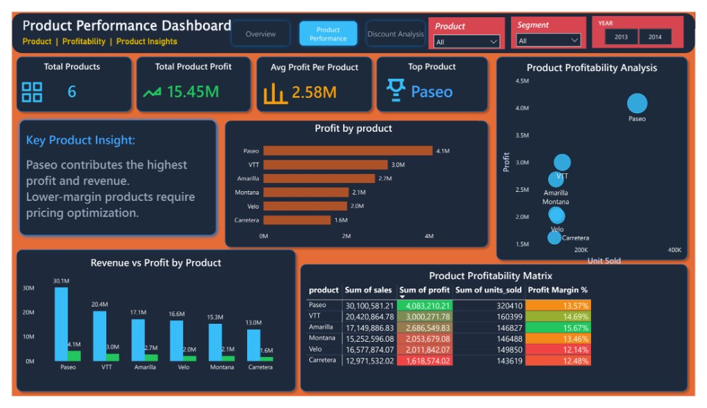

# Financial Performance Analytics Dashboard

An end-to-end data analytics project that transforms financial sales data into a structured MySQL dataset, analyzes business performance using SQL, and presents key insights through an interactive Power BI dashboard.

## Project Overview

The project explores financial performance across products, countries, business segments, time periods, and discount bands. It is designed to demonstrate a practical analytics workflow: data ingestion, relational data storage, SQL-based analysis, and business intelligence reporting.

**Dataset:** `dataset/Financial_Sample_dataset.csv`  
**Dataset size:** 700 rows and 16 source columns  
**Tools:** Python, Pandas, MySQL, PyMySQL, SQL, Microsoft Power BI

## Business Objectives

- Monitor core financial KPIs such as sales, profit, cost of goods sold (COGS), and units sold.
- Compare revenue and profitability across products, countries, and customer segments.
- Understand monthly sales and profit trends.
- Evaluate how discount bands relate to revenue and profit margins.
- Present findings in an interactive dashboard to support business analysis.

## Dashboard Pages

Add screenshots exported from your Power BI report to the `screenshots/` folder using the exact filenames below. The `.pbix` report is included in this repository, but screenshots are not included in the supplied project archive.

### 1. Overview


*Suggested caption: High-level financial KPIs and overall sales and profit performance.*

### 2. Product Analysis



*Suggested caption: Product-level revenue and profitability comparisons.*

### 3. Discount Analysis


*Suggested caption: Sales, profit, and margin comparisons across discount bands.*

> **Screenshot note:** Export or capture each report page from Power BI, save the images in `screenshots/`, and keep the filenames above. Until those images are added, GitHub will show broken image placeholders.

## Solution Architecture


### Workflow

1. **Data source:** The financial CSV file acts as the source dataset.
2. **Data ingestion:** `load_data.py` uses Pandas to read the CSV, standardize column names, handle missing values, and prepare records for insertion.
3. **Data storage:** PyMySQL connects Python to MySQL and inserts the records into the `financial_data` table.
4. **SQL analysis:** `financial_data_analysis.sql` contains table creation, data-quality checks, duplicate detection, KPI calculations, segment/country/product analysis, monthly trends, discount analysis, and a dashboard view.
5. **Business intelligence:** Power BI connects to the prepared data and presents the analysis through report pages.
6. **End user:** Dashboard users explore the report to understand financial performance.

## Repository Structure

```text
Financial_Performance_Dashboard/
│
├── dataset/
│   └── Financial_Sample_dataset.csv
│
├── assets/
│   └── architecture.png
│
├── screenshots/
│   ├── overview.png
│   ├── product-analysis.png
│   └── discount-analysis.png
│
├── load_data.py
├── financial_data_analysis.sql
├── Financial_Performance_Dashboard.pbix
└── README.md
```

## Technology Stack

| Technology | Purpose |
|---|---|
| Python | Data ingestion and preparation |
| Pandas | Reading CSV data, standardizing column names, handling missing values |
| PyMySQL | Connecting Python to MySQL |
| MySQL | Relational data storage and SQL analysis |
| SQL | Data validation, aggregation, KPI calculations, and analytical views |
| Power BI | Interactive dashboard and visual reporting |

## Setup and Execution

### Prerequisites

- Python 3.x
- MySQL Server and a MySQL client (such as MySQL Workbench)
- Microsoft Power BI Desktop
- Python packages: `pandas`, `pymysql`

### 1. Clone the repository

```bash
git clone <your-repository-url>
cd Financial_Performance_Dashboard
```

### 2. Install Python dependencies

```bash
pip install pandas pymysql
```

### 3. Create the MySQL database and table

Open `financial_data_analysis.sql` in MySQL Workbench and execute the database and table creation statements first.

**Important SQL correction before running the full script:** the supplied SQL file contains `DROP TABLE financial_data;` immediately after `CREATE TABLE financial_data (...)`. This removes the table that was just created. Remove or comment out that `DROP TABLE` statement before running the script. Only use `DROP TABLE` intentionally when you want to delete an existing table.

### 4. Configure the database connection

Open `load_data.py` and configure the MySQL connection for your local environment. Do not commit real database passwords to GitHub. Prefer environment variables or a local `.env` file that is excluded through `.gitignore`.

The original script contains a hard-coded password. Replace it before running, and rotate that password if it has ever been shared publicly.

### 5. Load the CSV data

From the project root, run:

```bash
python load_data.py
```

The script reads the CSV from `dataset/Financial_Sample_dataset.csv` and inserts records into the MySQL `financial_data` table.

### 6. Run the SQL analysis

Execute the relevant statements in `financial_data_analysis.sql` to perform data-quality checks and create the cleaned dataset, KPI summaries, analytical queries, and `financial_dashboard_view`.

Review the script in sequence. The table must exist and be populated before running queries that read from it. If rerunning the loader, clear or otherwise manage existing rows first to avoid duplicate inserts.

### 7. Open the Power BI report

Open `Financial_Performance_Dashboard.pbix` in Power BI Desktop. If the report prompts for a data source, update the connection to your local MySQL instance and select the appropriate database/view. Refresh the data, then review the report pages.

## SQL Analysis Covered

- **Data quality:** checks for negative sales, profit, or units sold.
- **Duplicate detection:** identifies repeated records using segment, country, product, and order date.
- **Data preparation:** creates a deduplicated `financial_cleaned` table using `ROW_NUMBER()`.
- **KPI analysis:** calculates total revenue, total profit, profit margin, units sold, and average discounts.
- **Segment analysis:** compares revenue, profit, and profit margin by segment.
- **Geographical analysis:** compares sales and profit by country.
- **Time-series analysis:** summarizes monthly revenue and profit.
- **Product analysis:** ranks products by revenue and profit.
- **Discount analysis:** compares revenue, profit, and profit margin across discount bands.
- **Dashboard dataset:** creates `financial_dashboard_view` for reporting.

## Key Business Questions

1. Which products contribute the most to revenue and profit?
2. Which business segments generate the strongest financial performance?
3. Which countries contribute the largest share of sales?
4. How do revenue and profit change over time?
5. How do discount bands relate to sales, profit, and profit margin?
6. Are there data-quality issues or duplicate records that should be addressed before reporting?

## Important Notes and Limitations

- The supplied archive includes the Power BI report file, but does not include exported dashboard screenshots. Add the three images described in the Dashboard Pages section.
- The SQL script should be reviewed and corrected before execution, particularly the `DROP TABLE financial_data;` statement.
- The Python loader currently uses hard-coded connection credentials. Move credentials to environment variables and never publish secrets.
- The loader uses `INSERT` statements. Re-running it without clearing or deduplicating the destination table may insert duplicate rows.
- Validate the data model and Power BI source connection in your own local environment before publishing the report.

## Future Enhancements

- Move database credentials to environment variables and add robust exception handling.
- Add logging and validation for row counts, null values, and duplicate records during ingestion.
- Make the ingestion process idempotent so repeated runs do not duplicate data.
- Add automated data-quality checks and reusable SQL views.
- Publish the Power BI report to Power BI Service with appropriate access controls.
- Add documented KPI definitions and business recommendations based on the final dashboard findings.

## Author

**Your Name**  
Data Analytics Project | Python • SQL • MySQL • Power BI

---

If you find this project useful, feel free to star the repository.
