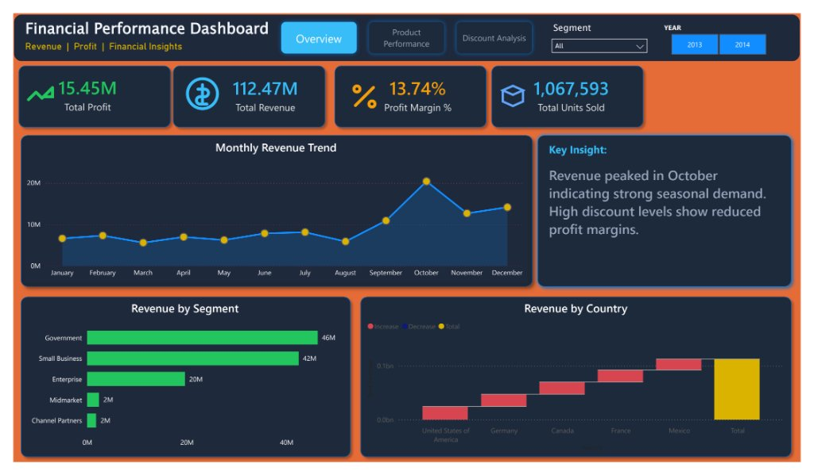
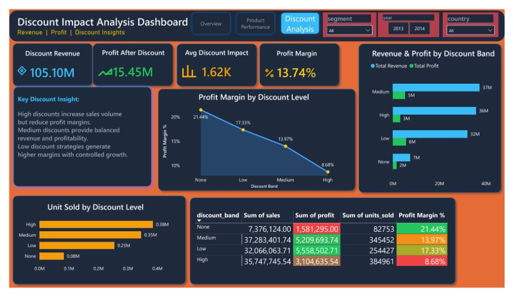
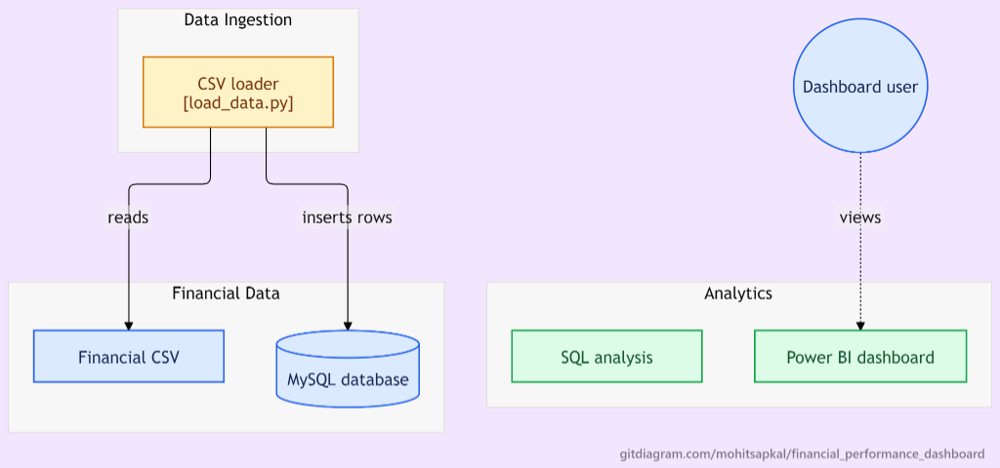

# 📊 Financial Performance Analytics Dashboard

An end-to-end data analytics and business intelligence solution that transforms raw financial transaction data into structured relational tables, executes analytical SQL transformations, and delivers executive-level reporting through an interactive Microsoft Power BI dashboard.

> *"In today's fast-evolving analytical world, data is no longer just historical record-keeping—it is the strategic pulse that turns complex operational noise into actionable clarity, competitive advantage, and measurable business growth."*

<p align="center">
  
  
  
  
  
</p>

---

## 📑 Table of Contents

- [📌 Executive Summary](#-executive-summary)
  - [🛠️ Technical Stack](#️-technical-stack)
- [📈 Power BI Dashboard Pages](#-power-bi-dashboard-pages)
  - [1. Executive Overview](#1-executive-overview)
  - [2. Product Performance Analysis](#2-product-performance-analysis)
  - [3. Discount Impact Analysis](#3-discount-impact-analysis)
- [🎯 Business Objectives](#-business-objectives)
- [💡 Key Performance Indicators](#-key-performance-indicators)
- [🏗️ System Architecture](#️-system-architecture)
- [📁 Repository Structure](#-repository-structure)
- [🗄️ Database Schema and Data Dictionary](#️-database-schema-and-data-dictionary)
- [⚡ SQL Analytical Framework](#-sql-analytical-framework)
- [🚀 Installation and Setup Guide](#-installation-and-setup-guide)
- [🔒 Production and Security Best Practices](#-production-and-security-best-practices)
- [📜 License and Attribution](#-license-and-attribution)

---

## 📌 Executive Summary

In a modern analytical world where real-time visibility dictates market leadership, organizations must bridge the gap between fragmented transaction records and executive decision-making. This project establishes a robust business intelligence pipeline to evaluate financial performance across global markets, customer segments, product categories, and discount structures. The solution bridges automated data ingestion, relational schema modeling, data cleansing, SQL-based performance aggregation, and visual analytics.

### 🛠️ Technical Stack

| Component | Technology | Badge / Logo | Description |
|---|---|---|---|
| Ingestion & Preprocessing | Python 3, Pandas |   | Automated header normalization, null handling, and type formatting |
| Database Connector | PyMySQL |  | High-performance bulk database loading |
| Storage & Modeling | MySQL Server |  | Relational storage, schema constraints, and deduplication logic |
| Analytical Processing | SQL (MySQL dialect) |  | Data quality checks, window functions, and analytical reporting views |
| Visual Analytics | Microsoft Power BI |  | Multi-page interactive executive dashboards and dimensional analysis |

---

## 📈 Power BI Dashboard Pages

The packaged Power BI report (`Financial_Performance_Dashboard.pbix`) consists of three analytical views placed at the forefront of the project:

### 1. Executive Overview



The Executive Overview delivers high-level visibility into core financial metrics and commercial trends across time, segments, and geographic regions.

- 📊 **KPI Scorecards:** Total Profit ($15.45M), Total Revenue ($112.47M), Profit Margin (13.74%), and Total Units Sold (1,067,593).
- 📈 **Monthly Revenue Trend:** Displays seasonal revenue patterns, highlighting an annual demand peak in October ($20M+).
- 🏢 **Revenue by Segment:** Ranks revenue contribution across sectors, led by Government ($46M), Small Business ($42M), and Enterprise ($20M).
- 🌍 **Revenue by Country:** Waterfall visualization depicting cumulative revenue contributions across operating countries (United States of America, Germany, Canada, France, and Mexico).
- 🔍 **Interactive Slicers:** Segment and fiscal year filters (2013, 2014) for targeted cohort analysis.

---

### 2. Product Performance Analysis


The Product Performance view assesses profitability, sales volume, and margin health across the product catalog.

- 📦 **Summary Cards:** Total Products (6), Total Product Profit ($15.45M), Average Profit per Product ($2.58M), and Top Product identifier (**Paseo**).
- 🏆 **Profit by Product:** Horizontal comparison ranking products by profit generation (Paseo leading at $4.1M, followed by VTT at $3.0M and Amarilla at $2.7M).
- 🔵 **Product Profitability Analysis:** Scatter plot correlating unit sales volume against total realized profit.
- 📊 **Revenue vs Profit by Product:** Clustered bar chart illustrating gross sales against net profit for each catalog item.
- 📋 **Product Profitability Matrix:** Detailed tabular view reporting Sum of Sales, Sum of Profit, Unit Volume, and Profit Margin Percentage by product (highlighting Amarilla with the highest profit margin at 15.67%).

---

### 3. Discount Impact Analysis



The Discount Impact Analysis evaluates the relationship between discount tiers, unit transaction volumes, and operational margins.

- 💰 **Summary Cards:** Discount Revenue ($105.10M), Profit After Discount ($15.45M), Average Discount Impact ($1.62K), and Overall Profit Margin (13.74%).
- 📉 **Profit Margin by Discount Level:** Demonstrates clear margin compression as discounts escalate:
  - **None:** 21.44% margin
  - **Low:** 17.33% margin
  - **Medium:** 13.97% margin
  - **High:** 8.68% margin
- 📊 **Revenue and Profit by Discount Band:** Compares top-line revenue against realized profit across tiers.
- 📦 **Units Sold by Discount Level:** Confirms volume expansion at higher discount tiers (High: 384,961 units; Medium: 345,452 units; Low: 254,427 units; None: 82,753 units).
- 📋 **Discount Band Performance Matrix:** Consolidated data grid comparing sales, net profit, unit count, and margin realization.

---

## 🎯 Business Objectives

- **Executive Visibility:** Provide leadership with unified visibility into total revenue, gross profit, cost of goods sold (COGS), and unit sales volume.
- **Dimensional Performance:** Compare commercial outcomes across customer segments (Government, Small Business, Enterprise, Midmarket, Channel Partners) and geographic regions.
- **Product Portfolio Evaluation:** Identify top-performing product lines by total gross revenue and net profit contribution.
- **Discount Optimization:** Analyze discount bands (None, Low, Medium, High) to evaluate price realization and determine impact on operating margins.
- **Temporal Analysis:** Track month-over-month and year-over-year revenue and profit trajectory to detect seasonality.

---

## 💡 Key Performance Indicators

The analytics pipeline computes the following primary business metrics:

- 💵 **Total Revenue:** Aggregate gross sales minus applicable discounts ($112.47M).
- 📈 **Gross Profit:** Net revenue minus cost of goods sold ($15.45M).
- 📊 **Profit Margin Percentage:** `(Total Profit / Total Sales) * 100` (13.74%).
- 📦 **Total Units Sold:** Cumulative transaction volume across all product lines (1,067,593 units).
- 🏷️ **Average Discount Impact:** Mean discount value applied across recorded sales transactions ($1.62K).
- ⚙️ **Cost of Goods Sold (COGS):** Total manufacturing and direct product fulfillment costs.

---

## 🏗️ System Architecture

The data pipeline follows an extract-transform-load (ETL) and analytical reporting architecture:



### End-to-End Workflow

1. 📄 **Source Data:** The pipeline originates with raw transactional data stored in `dataset/Financial_Sample_dataset.csv`.
2. 🐍 **Data Ingestion (`load_data.py`):** A Python ingestion script reads the source CSV via Pandas, cleanses column headers to snake_case, converts empty strings or missing entries into `None` (`NULL` in MySQL), and executes parameterized batch insertions using PyMySQL.
3. 🗄️ **Relational Storage (MySQL):** The ingested data is loaded into `financial_data`. Integrity checks audit for anomalies, and a window function (`ROW_NUMBER()`) produces a deduplicated table `financial_cleaned`.
4. ⚡ **Analytical SQL Engine:** Pre-aggregated metrics, segment distributions, and the dedicated reporting view `financial_dashboard_view` are compiled in `financial_data_analysis.sql`.
5. 📊 **Business Intelligence (Power BI):** Microsoft Power BI connects directly to the relational database to present interactive executive reporting across three analytical views.
6. 👤 **End User:** Business decision-makers filter and explore data dimensions to identify revenue growth and margin optimization opportunities.

---

## 📁 Repository Structure

```text
Financial_Performance_Dashboard/
│
├── assets/
│   └── architecture.png                 # System architecture diagram
│
├── dataset/
│   └── Financial_Sample_dataset.csv     # Source transaction records (700 rows, 16 attributes)
│
├── screenshots/
│   ├── overview.png                     # Dashboard Page 1: Executive KPI Overview
│   ├── product-analysis.png             # Dashboard Page 2: Product Performance Analysis
│   └── discount-analysis.png            # Dashboard Page 3: Discount Impact Analysis
│
├── financial_data_analysis.sql           # Database creation, QA, deduplication, and KPI queries
├── load_data.py                         # Automated Python ingestion script
├── Financial_Performance_Dashboard.pbix # Packaged Power BI dashboard file
└── README.md                            # Comprehensive project documentation
```

---

## 🗄️ Database Schema and Data Dictionary

The data model captures individual product order transactions with the following specifications:

| Column Name | Data Type | Nullable | Description |
|---|---|---|---|
| `id` | INT | No | Auto-incrementing primary key |
| `segment` | VARCHAR(50) | Yes | Target customer market segment |
| `country` | VARCHAR(50) | Yes | Sales destination country |
| `product` | VARCHAR(50) | Yes | Product catalog item name |
| `discount_band` | VARCHAR(20) | Yes | Discount classification (None, Low, Medium, High) |
| `units_sold` | INT | Yes | Number of product units transacted |
| `manufacturing_price`| DECIMAL(10,2) | Yes | Per-unit manufacturing cost |
| `sale_price` | DECIMAL(10,2) | Yes | Per-unit standard retail price |
| `gross_sales` | DECIMAL(12,2) | Yes | Revenue before discount deductions |
| `discounts` | DECIMAL(12,2) | Yes | Total discount dollar value applied |
| `sales` | DECIMAL(12,2) | Yes | Net revenue realized after discounts |
| `cogs` | DECIMAL(12,2) | Yes | Total cost of goods sold |
| `profit` | DECIMAL(12,2) | Yes | Net profit earned (`sales - cogs`) |
| `order_date` | DATE | Yes | Transaction calendar date |
| `month_number` | INT | Yes | Numerical month identifier (1-12) |
| `month_name` | VARCHAR(20) | Yes | Full calendar month name |
| `year` | INT | Yes | Transaction fiscal year |

---

## ⚡ SQL Analytical Framework

The accompanying SQL suite (`financial_data_analysis.sql`) executes comprehensive data auditing and business aggregation steps:

### 1. Data Integrity and Sanity Auditing
Verifies whether anomalies exist within the primary financial columns:
```sql
SELECT *
FROM financial_data
WHERE sales < 0
   OR profit < 0
   OR units_sold < 0;
```

### 2. Deduplication via Window Partitioning
Eliminates duplicate transactions across core attributes using `ROW_NUMBER()`:
```sql
CREATE TABLE financial_cleaned AS
SELECT * FROM (
    SELECT *,
           ROW_NUMBER() OVER (
               PARTITION BY segment, country, product, order_date
               ORDER BY order_date
           ) AS row_num
    FROM financial_data
) t
WHERE row_num = 1;
```

### 3. Executive KPI Aggregation
Calculates enterprise-level commercial performance:
```sql
SELECT 
    SUM(sales) AS total_revenue,
    SUM(profit) AS total_profit,
    ROUND((SUM(profit) / SUM(sales)) * 100, 2) AS profit_margin_percent,
    SUM(units_sold) AS total_units_sold,
    AVG(discounts) AS avg_discount
FROM financial_cleaned;
```

### 4. Segment and Geographic Performance
Analyzes revenue distribution and operational margin by customer type and country:
```sql
SELECT 
    segment,
    SUM(sales) AS total_revenue,
    SUM(profit) AS total_profit,
    ROUND((SUM(profit) / SUM(sales)) * 100, 2) AS profit_margin_percent
FROM financial_cleaned
GROUP BY segment
ORDER BY total_revenue DESC;
```

### 5. Production Reporting View
Constructs a dedicated view for external consumption by Power BI:
```sql
CREATE VIEW financial_dashboard_view AS
SELECT 
    segment,
    country,
    product,
    discount_band,
    year,
    month_number,
    month_name,
    units_sold,
    sales,
    cogs,
    profit
FROM financial_cleaned;
```

---

## 🚀 Installation and Setup Guide

### Prerequisites
- Python 3.8 or higher
- MySQL Server (8.0+ recommended) and MySQL Workbench
- Microsoft Power BI Desktop
- Required Python libraries: `pandas`, `pymysql`

### Step 1: Clone the Repository
```bash
git clone https://github.com/mohitsapkal/financial_performance_dashboard.git
cd Financial_Performance_Dashboard
```

### Step 2: Install Python Dependencies
```bash
pip install pandas pymysql
```

### Step 3: Initialize Database Schema
1. Open MySQL Workbench and connect to your MySQL Server instance.
2. Open `financial_data_analysis.sql`.
3. Execute **Step 1** (Database creation) and **Step 2** (Table creation).
   > Note: Ensure any standalone `DROP TABLE` statements are not executed unintentionally during initial creation.

### Step 4: Ingest Data via Python
1. Open `load_data.py`.
2. Configure database host, user credentials, and database name.
3. Run the ingestion script:
```bash
python load_data.py
```
Upon completion, the terminal displays the count of rows successfully loaded.

### Step 5: Execute Analytical Queries and View Generation
1. Return to MySQL Workbench and execute Steps 3 through 13 in `financial_data_analysis.sql`.
2. Confirm the creation of `financial_cleaned` and `financial_dashboard_view`.

### Step 6: Connect and Refresh Power BI Report
1. Launch `Financial_Performance_Dashboard.pbix` in Microsoft Power BI Desktop.
2. Under **Home** > **Transform Data** > **Data source settings**, point the connection to your local MySQL instance (`localhost`, database: `financialanalyticsdb`).
3. Click **Close & Apply** to refresh visualizations against the populated database.

---

## 🔒 Production and Security Best Practices

1. **Environment Credential Management:**
   Never commit database credentials directly into version control. Manage credentials using environment variables or configuration files excluded by `.gitignore`:
   ```python
   import os
   import pymysql

   conn = pymysql.connect(
       host=os.getenv('DB_HOST', 'localhost'),
       user=os.getenv('DB_USER', 'root'),
       password=os.getenv('DB_PASSWORD'),
       database=os.getenv('DB_NAME', 'financialanalyticsdb')
   )
   ```

2. **Idempotent Ingestion:**
   In corporate ETL environments, replace direct row appending with staging tables or `TRUNCATE` / `ON DUPLICATE KEY UPDATE` patterns to ensure rerunning pipelines does not introduce duplicate rows.

3. **Data Quality Governance:**
   Implement automated schema assertions and range validation checks prior to loading records into downstream analytical views.

---

## 📜 License and Attribution

Distributed under the MIT License. Developed for data engineering and business analytics demonstration purposes.
